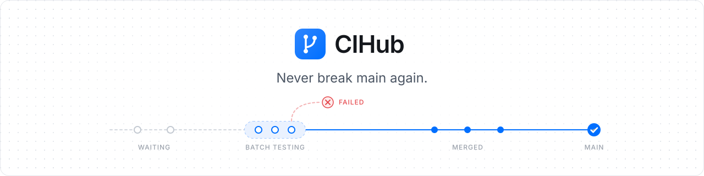

  <picture>
    <source media="(prefers-color-scheme: dark)" srcset="../assets/banner-dark.svg">
    
  </picture>

Two pull requests pass CI on their own. You merge both. `main` is red, and nobody knows why.

CIHub makes that impossible. Approve a pull request, type `/cihub merge`, and go back to work. CIHub lines it up
behind the others, tests it together with everything that lands before it, and merges it only if the result still
passes. No rebase loop, no broken `main`, no "who merged that?".

- **Green by design.** What gets tested is exactly what lands.
- **Your CI, unchanged.** GitHub Actions, Buildkite, Jenkins: if it reports a check, CIHub waits for it.
- **Yours to run.** One container and a Postgres. Your code stays on your infrastructure.
- **Never a mystery.** Each pull request says where it stands in the queue and what it waits for.
- **Quick when it gets busy.** Pull requests are tested in parallel or in batches, and one flaky failure does
  not kick anyone out.
